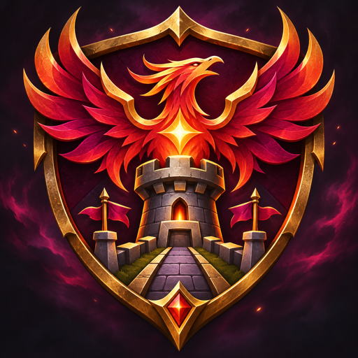

# Legion TD Community Enhanced 1.1.1

The project adopts the name **Legion TD Community Enhanced (LTDCE)**. The map title, in-game information, website and player guide now use the new name. The 1.1.1 map contains the same gameplay as FEmbussy 1.1.0. [Release notes](releases/1.1.1/CHANGELOG.md)

---

  
  <h1>LEGION TD FEMBUSSY</h1>
  
<strong>VERSION 1.1.0 · MATCH CONTROL & COMMUNITY IDENTITY</strong>

  
Sharper solo testing, a more responsive vote-kick for extreme team gaps, and a fully branded in-game identity.

  

    
    
    
  

  
<a href="https://github.com/ltdce/LTDCE/releases/download/v1.1.0/Legion_TD_Fembussy_1.1.0.w3x"><strong>⬇ DOWNLOAD THE MAP</strong></a>

---

## ✨ What changed

### 🧭 Host wave control is now solo-only

`-wave N` now works only when exactly one human player is in the match, and only the host can use it. This keeps the command available for solo testing without letting it alter multiplayer rounds. Wave range remains **1–31**.

### ⚖️ Extreme underperformance lowers the vote-kick threshold

Type `-vk` to open the vote-kick menu. The usual vote requirement is capped at **3** if the target’s unit value or income is **strictly below 30%** of the corresponding average for their other active teammates. For example, 299 in unit value qualifies when their teammates average 1,000. A value of 300 by itself does not qualify. Otherwise, the original requirement applies.

### 🏷️ The map identifies as Legion TD FEMBUSSY

The Warcraft III map name, quest panel, and in-game information now use the **Legion TD FEMBUSSY** identity. The information panel describes this community edition and its features while preserving credit to the original Team OZE map.

## 🔎 Full OZE comparison

See the [complete file-by-file comparison with the supplied Team OZE map](https://github.com/ltdce/LTDCE/blob/main/DIFFERENCES.md), including every changed MPQ entry and the gameplay changes.

## 📦 Release details

| | |
| --- | --- |
| **Map file** | `Legion_TD_Fembussy_1.1.0.w3x` |
| **Base** | Legion TD 11.4c-hf9 |
| **Release tag** | [`v1.1.0`](https://github.com/ltdce/LTDCE/releases/tag/v1.1.0) |
| **Map name** | Legion TD FEMBUSSY 1.1.0 |

> **Validation:** The map archive was rebuilt and reopened successfully. Its embedded map name, author, description, branding strings, and Lua payload were checked. In-client multiplayer behavior still needs a Warcraft III session to verify.

---

Unofficial community modification. Original base: Legion TD 11.4c-hf9 Team OZE.

