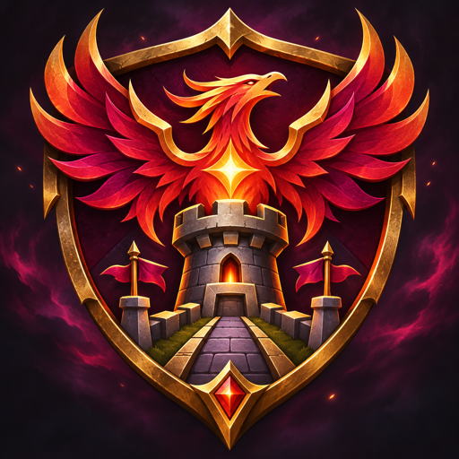

  
  <h1>LEGION TD OZE → FEMBUSSY</h1>
  
<strong>COMPLETE CHANGE RECORD · VERSION 1.1.0</strong>

  
A file-by-file and gameplay comparison of the supplied Team OZE map and the published FEMBUSSY edition.

---

## Comparison scope

Legion TD Community Enhanced 1.1.1 retains these gameplay changes. The names and version numbers below describe the historical 1.1.0 build. [Notes for 1.1.1](releases/1.1.1/CHANGELOG.md)

This comparison uses the supplied **Legion TD 11.4c-hf9 Team OZE** map as the baseline and **Legion TD FEMBUSSY 1.1.0** as the finished map. FEMBUSSY is an unofficial community edition based on that 11.4c-hf9 map.

Both MPQ archives contain **756 entries**. The extraction found **no added or removed entries**: six named map files changed, and the other 750 entries match. Of the six changed files, three contain gameplay or object data and three contain map text/metadata.

## Gameplay and match systems

### Pick mode

- The host can enable **Pick** in the opening mode selector. The Pick button is placed alongside the existing mode controls.
- When enabled, each player can use `-pick` to view their current roll and `-pick N` to lock one of its six tier slots.
- A player can lock only one unit per match. Rerolls keep that unit in its chosen slot; the other slots continue to reroll.
- Pick is unavailable when the host leaves the mode disabled.

### Host wave command

- `-wave N` jumps to wave **1–31**.
- Only the host can use it, and only when exactly **one human player** is in the match.
- In solo testing, the countdown reaching zero now starts the match instead of leaving it stalled.

### King recovery

- When the King loses a life, the recovery effect restores **100% of the King’s maximum health**.
- If a player leaves and their team’s King has already lost a life, that King receives **10% additional health regeneration**.

### Team support after a departure

When a player leaves during a match, the remaining players on that team receive immediate Basic Lumberjack Training if their team average is at least **15% behind** the opposing team’s average in value **or** income.

| Match level when the player leaves | Training for each remaining teammate |
| --- | ---: |
| Before level 10 | +1 level |
| Level 10–19 | +2 levels |
| Level 20 onward | +3 levels |

### Vote-kick

Type `-vk` to open the vote-kick menu. The usual vote requirement is capped at **3** if the target’s unit value or income is **strictly below 30%** of the corresponding average for their other active teammates. For example, 299 in unit value qualifies when their teammates average 1,000. A value of 300 by itself does not qualify. Otherwise, the original requirement applies.

### Unit changes

| Unit / ability | Team OZE baseline | FEMBUSSY 1.1.0 |
| --- | --- | --- |
| **Ent / Guardian root** | 20-second repeat cooldown | 6 seconds |
| **Wolverine / Madness** | 1.5-second damage-immunity effect | 3 seconds |

The Wolverine immunity threshold was intended to remain at **15% health**, as specified during the requested change. There is a tooltip mismatch: the OZE and FEMBUSSY tooltip both state **20%**. The tooltip wording changed, but its displayed percentage did not. The comparison does not claim that the in-game trigger threshold was independently verified.

## Ranking, protections, and local record

- The old ELO/rank scoring and Legion TD API-backed ranking path are disabled.
- Integrity/expiration protections that could interrupt or end a match were removed.
- The former score area now shows a **local player record**: games played, wins, and departures. The record is saved locally for that player; it is not an online ranking.

## Map identity and information

- The Warcraft III map-list name is now **Legion TD FEMBUSSY 1.1.0**.
- The W3I author changes from **Team OZE** to **Team FEMBUSSY**. The description identifies the map as an unofficial community edition based on 11.4c-hf9. The recommended-player field remains `1v1, 2v2, 4v4`.
- The F9 quest panel and map information/resource tooltips use FEMBUSSY branding and describe its features. Original Team OZE map credit remains in the information text.
- The downloadable map follows the versioned filename `Legion_TD_Fembussy_1.1.0.w3x`.

## Exact MPQ file inventory

| File | Difference found |
| --- | --- |
| `war3map.lua` | Contains the Pick mode, wave command, King recovery, departure support, vote threshold, local record, and removal/disablement of ranking and protection behavior described above. |
| `war3map.w3a` | Ability `A926` (Madness): normal and hero duration fields change from **1.5** to **3.0** seconds. |
| `war3map.w3u` | Unit `h02Y` (Guardian): raw field `umpr` (base mana regeneration) changes from **2.5** to **8.33333397**. This data difference is present in the shipped map; its intended gameplay purpose was not established from the change history. |
| `war3map.w3i` | Map name, author, and description change as described above. The recommended-player field is unchanged. |
| `war3map.wts` | Eight displayed strings change: Ent root cooldown; Wolverine Berserk duration and tooltip wording; F9 quest heading/name and info text; and the map information/resource tooltip. The Wolverine tooltip still says 20%. |
| `war3mapSkin.txt` | Six interface labels/tooltips change: F9 quest name, upkeep information, map version label, and quest button title/help text. |

No other named or unnamed MPQ entries differed in this comparison.

## Downloads and release notes

- [Download FEMBUSSY 1.1.0](https://github.com/geovannec/LTDCE/releases/download/v1.1.0/Legion_TD_Fembussy_1.1.0.w3x)
- [Read the 1.1.0 release notes](https://github.com/geovannec/LTDCE/blob/main/releases/1.1.0/CHANGELOG.md)

> The repository publishes release files and documentation. It does not publish map source code.

Unofficial community modification. Original map base: Legion TD 11.4c-hf9 Team OZE.

