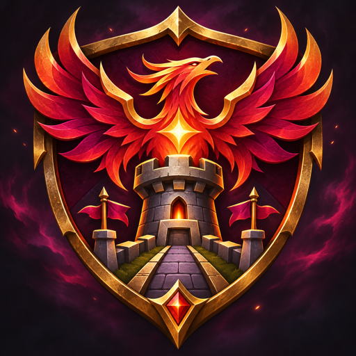

  
  <h1>LEGION TD FEMBUSSY</h1>
  
<strong>Community releases · bug reports · ideas</strong>

  
An unofficial Warcraft III tower-defense map edition based on Legion TD 11.4c-hf9.

  

    
    
  

  
<a href="https://github.com/geovannec/LTD_Fembussy/releases/latest"><strong>⬇ Get the latest map</strong></a>

---

## What this project is

This repository publishes playable map releases and their changelogs. Use GitHub Issues to report bugs or suggest improvements. **Map source code is not published here.**

## Latest release

### [Legion TD Fembussy 1.0.0](https://github.com/geovannec/LTD_Fembussy/releases/tag/v1.0.0)

- Pick mode and host wave-jump command
- Team support when a player leaves
- King healing and unit balance updates
- Local match record; old ELO/API integration removed

Read the [full changelog](releases/1.0.0/CHANGELOG.md) or [download the map](https://github.com/geovannec/LTD_Fembussy/releases/download/v1.0.0/Legion_TD_Fembussy_1.0.0.w3x).

## Help improve the map

- **Bug report:** [Open an issue](https://github.com/geovannec/LTD_Fembussy/issues/new?labels=bug) with the release version, game mode, what happened, and steps to reproduce it.
- **Suggestion:** [Open an enhancement issue](https://github.com/geovannec/LTD_Fembussy/issues/new?labels=enhancement) with the proposed change and why it would help.

Please do not attach personal information or account credentials to issues.

---

Unofficial community modification. Original base: Legion TD 11.4c-hf9 Team OZE.

