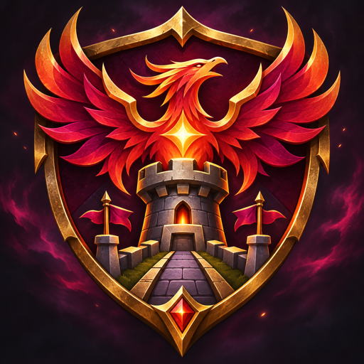

  
  <h1>LEGION TD FEMBUSSY</h1>
  
<strong>VERSION 1.0.0 · FIRST PUBLIC RELEASE</strong>

  
A fresh community edition of Legion TD 11.4c-hf9, built around player choice, clearer match control, and stronger recovery tools.

  

    
    
    
  

  
<a href="https://github.com/geovannec/LTDCE/releases/download/v1.0.0/Legion_TD_Fembussy_1.0.0.w3x"><strong>⬇ Download the map</strong></a>

---

## At a glance

| 🎲 Player choice | 🧭 Match control | 🤝 Leaver recovery | 📊 Local record |
| :---: | :---: | :---: | :---: |
| Lock one unit per game | Host can jump to any wave | Wave-scaled team bonuses | Games, wins, and leaves |

## 🎮 Pick your line-up

The host can enable **Pick** during the opening mode selection. Each player may use `-pick N` once per game to lock a unit from their current roll. The selected slot keeps that unit through every reroll; the other slots continue rerolling normally.

## 🧭 Take control of the waves

The host can type `-wave N` to jump to any wave from **1 to 31**, forward or backward. If a round or arena fight is active, the requested wave begins after the current combat has cleared.

## 🤝 A fairer recovery when someone leaves

When a player leaves, the map compares the remaining players' team averages. If the affected team is at least **15% behind** in average value **or** income, each remaining teammate immediately gains Basic Lumberjack Training:

| Current wave | Training gained |
| :---: | :---: |
| Waves 1–9 | +1 level |
| Waves 10–19 | +2 levels |
| Waves 20+ | +3 levels |

If that team's King has already lost a life, it also gains **10% bonus health regeneration**.

## ⚔️ Balance and survival

| Unit / mechanic | Change |
| --- | --- |
| **King** | Restores **100% of maximum health** when a life is lost. |
| **Ent** | Root ability cooldown reduced to **6 seconds**. |
| **Wolverine** | Madness damage immunity increased from **1.5 to 3 seconds**. Its trigger remains at **15% health**. |

## 📊 Your match record stays local

The former ranking score area now displays an incremental local record of games played, wins, and departures. The old ELO/ranking integration and its Legion TD API calls are disabled.

## 🛠️ Reliability fixes

- Removed integrity and expiration protections that could interrupt a match.
- Fixed solo testing so the game proceeds into the first wave when the countdown ends.

## 📦 Release details

| | |
| --- | --- |
| **Map file** | `Legion_TD_Fembussy_1.0.0.w3x` |
| **Game version** | Legion TD 11.4c-hf9 base |
| **Release tag** | [`v1.0.0`](https://github.com/geovannec/LTDCE/releases/tag/v1.0.0) |

> **Validation status:** The MPQ archive and embedded map name were checked. Full multiplayer matches and local save behavior still need in-client testing in Warcraft III.

---

Unofficial community modification. Original base: Legion TD 11.4c-hf9 Team OZE.

